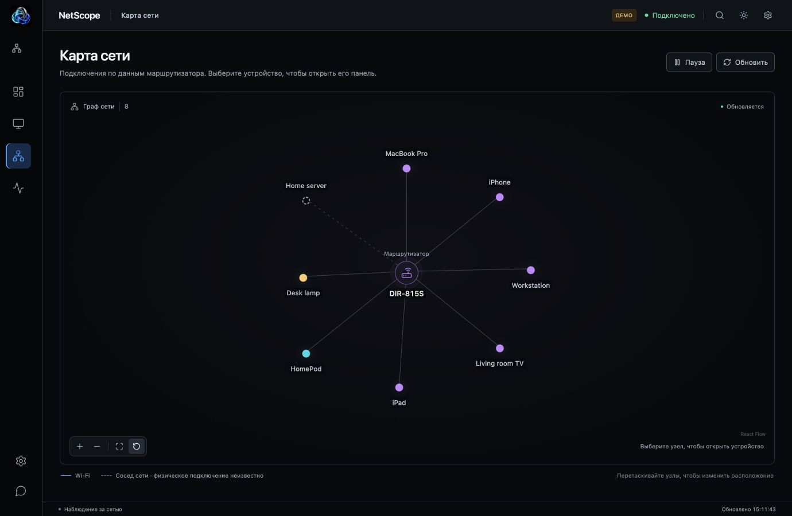
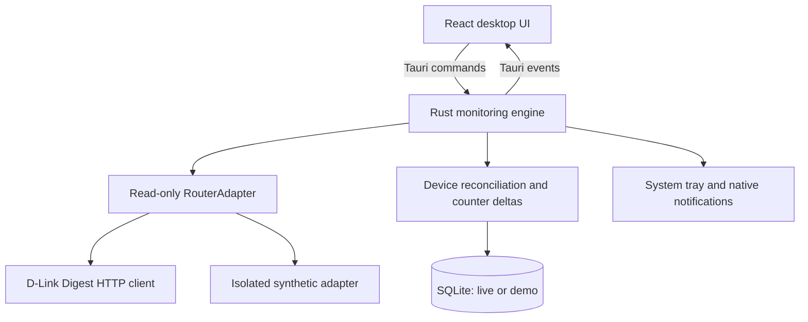

<div align="center">
  
  <h1>NetScope</h1>
  <p>Your network, in focus.</p>
  <p>A private, read-only desktop network monitor for macOS and Windows.<br/>Tauri 2 · Rust · React · TypeScript · SQLite</p>
</div>

NetScope brings router observations into a desktop workspace with light, black and system themes: an interactive network map, device registry, local history, and connection events. The installed application includes its native backend and frontend. End users do not need Node, Rust, Python, Docker, a browser tab, or a separate server.

The application interface, native menus, notifications, and Windows installer are in Russian. See the [GitHub release guide](docs/github-release-ru.md), [background mode and Alcove setup](docs/background-alcove-ru.md), and [requesting support for a new router](docs/router-support-ru.md). Feedback: [Telegram @allllllIlIl](https://t.me/allllllIlIl).

**Basic physical-router connection verified on macOS, 2026-11-01.** The signed installed app authenticated, discovered five devices, and the user confirmed live updates. Extended [DIR-815S S1 acceptance](docs/hardware-test.md), counter directions, RSSI encoding, and Windows smoke tests remain pending.

## Screenshots

The interface has light and black themes with colored device icons, Wi-Fi bands and availability states. Theme selection is saved locally and can follow the operating system.



Screenshots use **DEMO MODE** only. See [validation](docs/validation.md) for the verification method and remaining hardware checks.

## Features

- A simplified four-section navigation: Overview, Devices, Network Map, and Activity (Traffic/Events). Router details are linked from connection settings.
- A native application window, app icon, menu bar/system tray, persistent window geometry, and native notifications.
- First-launch setup with a separate password-free reachability check, specific connection errors, connection verification and an explicitly selected Demo Mode.
- D-Link HTTP Digest, including `anweb-authenticate`, nonce count, stale challenges, cookies, timeouts, bounded retries, and refused redirects.
- One configurable combined request for the confirmed `/devinfo?area=187%7C64&need_auth=1&mandatory=1` endpoint. No guessed categories or router write operations.
- MAC normalization and deduplication across neighbor and Wi-Fi tables; multiple IPv4/IPv6 addresses per device.
- Online, stale, offline, and unknown states; an absence timeout; router failures never turn an entire network offline.
- Search, status/band filters, sorting, a compact device list, names, device types, icons, favorites, and hiding without deleting history.
- A draggable, pannable, zoomable React Flow map with selection, auto layout, reset, and fit controls. Connections represent logical observations.
- Counter-delta traffic estimates, radio link rate, raw RSSI, connected-device history, and a searchable event timeline.
- SQLite migrations, atomic observation commits, retention limits, five-minute rollups after 24 hours, and bounded chart queries.
- Session-only native credential storage. Passwords are never written to SQLite or browser storage.
- Isolated live/demo databases. No telemetry, remote fonts, accounts, or mandatory cloud services.

## Supported platforms

| Platform                 | Target                   | Packaging      | Verification                                                                 |
| ------------------------ | ------------------------ | -------------- | ---------------------------------------------------------------------------- |
| macOS 13+, Apple Silicon | `aarch64-apple-darwin`   | `.app`, `.dmg` | See [validation](docs/validation.md)                                         |
| Windows 10/11, x64       | `x86_64-pc-windows-msvc` | NSIS `.exe`    | Local cross-build available; native Windows CI and manual smoke test pending |

Windows uses WebView2. The installer can download its bootstrapper if the runtime is missing. The current local macOS package is signed with an existing Apple Development identity. It has no Developer ID distribution signature or notarization. See [release instructions](docs/releasing.md) before distributing builds.

## Supported routers

| Profile                      | Firmware                                         | Confirmed API                              | Status                                                                                       |
| ---------------------------- | ------------------------------------------------ | ------------------------------------------ | -------------------------------------------------------------------------------------------- |
| D-Link DIR-815S, revision S1 | Megafon-branded 1.0.0 from the supplied research | Area 187 neighbors + area 64 Wi-Fi clients | Basic native authentication/discovery and live updates verified; extended acceptance pending |

The model and revision shown in the app are the **selected profile**, not an API-detected identity. Firmware, WAN details, uptime, channels, DHCP, QoS, and router administration are shown as unavailable/planned. Router TX/RX directions and RSSI encoding remain unverified. `lastTxRate` is the **Wi-Fi Link Rate**, not internet throughput.

## Architecture



See [architecture](docs/architecture.md), [adapter contract](docs/router-adapters.md), and [security](docs/security.md).

## Installation

For a locally built macOS package, open the `.dmg` in `target/release/bundle/dmg/`, then drag NetScope to Applications. Alternatively open `target/release/bundle/macos/NetScope.app` directly. On Windows run the generated NSIS installer. Release automation creates draft releases; no binaries are published by merely checking out this repository.

Launch NetScope, select the D-Link profile, enter the private router IP, username, and password, then choose **Test & connect**. The app verifies Digest authentication and both response categories before starting monitoring. Grant local network access if macOS requests it. Credentials must be re-entered after the app exits.

## Development

Developer prerequisites: Node.js 22.12+ (24 LTS recommended), npm, stable Rust, and the [Tauri platform prerequisites](https://v2.tauri.app/start/prerequisites/). macOS needs Apple developer tools; Windows needs the MSVC C++ build tools and WebView2. Dependencies are locked in `package-lock.json` and `Cargo.lock`.

```sh
npm install
npm run tauri dev
```

`npm run dev` is the frontend build tool alone. The full desktop development command is `npm run tauri dev`. A standalone browser page deliberately does not impersonate the desktop runtime.

```sh
npm run build                    # TypeScript and embedded production assets
npm run tauri build              # Native binary and host-platform installers
npm run tauri build -- --bundles app,dmg  # macOS
npm run tauri build -- --target x86_64-pc-windows-msvc --bundles nsis # on Windows
```

Quality checks (from the repository root):

```sh
npm run lint
npm run test
npm run build
cargo test
cargo clippy --all-targets -- -D warnings
cargo fmt --check
```

The tests use synthetic fixtures and loopback mock servers. They never contact a home router. The test-only IPC harness uses Tauri's mock runtime.

## Configuration

Settings control polling (5–300 seconds), offline timeout (30–3600 seconds, at least two poll intervals), retention (1–30 days), notifications and event filters, and close-to-tray behavior. A combined request defaults to five seconds; collecting both tables atomically avoids inconsistent identities and duplicate calls. Native tasks continue while the window is hidden.

App data is stored in the OS application-data directory for `io.netscope.desktop`:

- macOS: `~/Library/Application Support/io.netscope.desktop/`
- Windows: `%APPDATA%\io.netscope.desktop\`

`netscope.sqlite` stores live history/preferences; `demo.sqlite` stores synthetic history. Logs live in Tauri's app log directory and contain static diagnostics and retry counts, never HTTP headers, credentials, responses, addresses, or device names. Seven daily log files are retained.

## Security

Only explicitly chosen private IPv4 literal addresses are accepted. Local DNS hostnames, IPv6 router endpoints, loopback destinations, public addresses, credentials embedded in URLs, paths, and query strings are rejected. Device IPv6 addresses remain fully supported. Redirects and environment proxies are disabled; TLS certificate verification remains enabled. The frontend has no HTTP, filesystem, or shell plugin permissions.

**HTTP Digest does not encrypt network statistics.** Use this HTTP firmware only on a trusted LAN. Session passwords live in Rust memory, use zeroizing owned storage, and never return through IPC. Cookies are session-local. OS keychain persistence is not included in this version. See [security](docs/security.md) for scope and storage details.

## Demo Mode

Choose **Explore Demo Mode** in setup. Eight synthetic devices form an example network; one periodically disappears long enough to exercise the absence timeout at the default poll rate. Counter activity and raw RSSI change while monitoring runs. Charts grow from these demo observations; historical points are not backfilled. The **DEMO MODE** badge remains visible throughout the workspace. Demo alerts are suppressed, and switching profiles never merges datasets.

## Roadmap

The next milestone is physical D-Link acceptance and Windows verification, followed by documented additional read-only categories. Router write operations belong to a later, separately researched version. See [roadmap](docs/roadmap.md) for release gates.

## Contributing

Read [CONTRIBUTING.md](CONTRIBUTING.md). Keep fixtures synthetic, preserve missing values as unknown, add protocol/registry tests for new behavior, and run all quality checks. Do not submit home-network databases, packet captures, router passwords, cookies, or unredacted screenshots.

## License

[MIT](LICENSE).
